## {background-image="img/w05/slide_002.jpg" background-size="contain" .fallback}
<!-- slide 2 -->

::: notes
Slide text: The Data Science Process: · Ask a Question · Get the Data · Explore the Data · Model the Data · Visualize the Results · Generate summary statistics · Mean, variance, range etc.  · Plot the data · Are there patterns?
:::

## {background-image="img/w05/739b7e9c55cd28f.jpg" background-size="contain"}
<!-- slide 3 -->

## {background-image="img/w05/slide_004.jpg" background-size="contain" .fallback}
<!-- slide 4 -->

::: notes
Slide text: Frequentism · Frequentist inference is the process of determining properties of an underlying distribution via the observation of data. · It relies on the Central Limit Theorem · Using the properties of a sample to estimate the parameters of a population · Thus, the nature of a sample is of extreme importance to the quality of inferences that can be drawn from it. · R.A. Fisher · He was alsoa eugenicist ☹
:::

## Bayesian thinking
<!-- slide 5 -->

::: {.columns}
:::: {.column width="49%"}
- Frequentist: probability is how often something happens over many repeats
- Bayesian: probability is how strongly you believe something
    - Prior: what you believe before you see the data
    - Posterior: what you believe after you see the data
- Thomas Bayes (1701–1761); his rule was published in 1763
- Today: one Bayesian idea that you can use every day
::::
:::: {.column width="51%"}
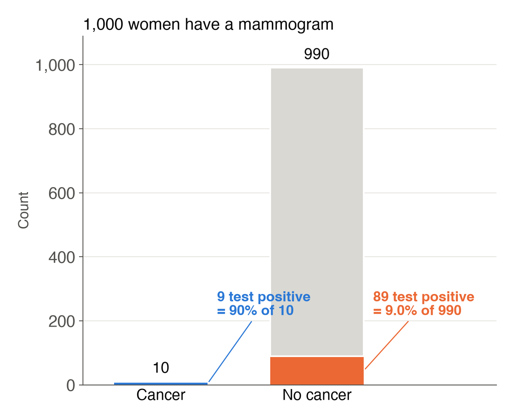{.pic style="max-height:631px"}

Mammogram example (next slides). Both bars use the same count scale.
::::
:::

::: notes
Contrast with the previous slide. Frequentist: a probability is a long-run frequency of a repeatable event; parameters are fixed and unknown. Bayesian: a probability is a degree of belief; parameters have distributions; evidence updates a prior into a posterior. We do not do Bayesian estimation in this module. The goal is one habit: always ask for the base rate. The chart is a teaser for the mammogram slides. Both bars use the same count scale: 90% of the 10 women with cancer test positive (9), but only 9% of the 990 without cancer do (89). So most positive tests (89 of 98) are false: the posterior is 9%, not 90%. Bayes' essay was published after his death by Richard Price (Philosophical Transactions, 1763).
:::

## A small % of a big number beats a big % of a small number
<!-- slide 6 -->

::: {.columns}
:::: {.column width="49%"}
- South Wales Police used live facial recognition at the 2017 Champions League final in Cardiff
- The system compared faces in the crowd with a watch list
- 93% of its alerts named the wrong person
- Why? A small error rate × a very big crowd is more than a high hit rate × a few wanted people
- Always ask: how big is each group?
::::
:::: {.column width="51%"}
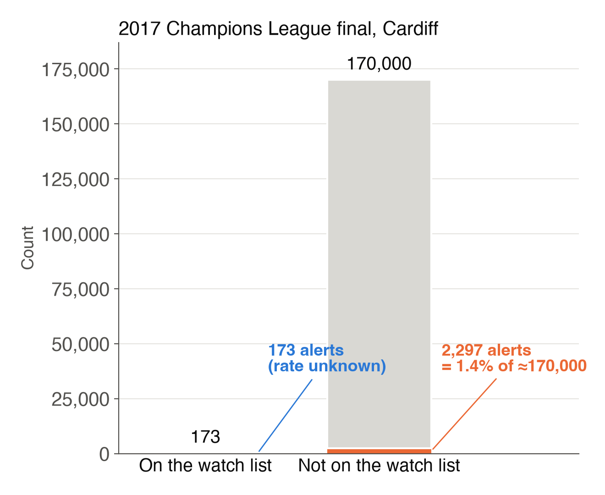{.pic style="max-height:631px"}

Source: South Wales Police figures, reported by The Guardian, 5 May 2018.
::::
:::

::: notes
South Wales Police data released in 2018: at the UEFA Champions League final in Cardiff (June 2017), the system made 2,470 alerts, and 2,297 (93.0%; press reports often say 92%) were false positives. About 170,000 people came to Cardiff for the match. The police said that no-one was arrested because of a false alert, and that officers checked each alert. The point: the system can be quite accurate per face and still give mostly false alerts, because almost everyone in the crowd is not on the watch list. The chart uses one count scale: the 173 correct alerts are a tiny bar next to the crowd of ~170,000, of whom 2,297 (1.4%) got a false alert. The number of wanted people in the crowd is not public, so the hit rate for the left bar is unknown. CHECK the figures against the Guardian article before the lecture.
:::

## The mammogram problem
<!-- slide 7 -->

::: {.columns}
:::: {.column width="49%"}
- 1% of women in a screening group have breast cancer
- The test detects 90% of cancers
- The test also flags 9% of healthy women
- A woman tests positive. What is the chance that she has cancer?
    - Answer: 9 of 98 positives, about 9%
    - Only 21% of 160 gynaecologists chose the right answer
- Tip: count people, not percentages
::::
:::: {.column width="51%"}
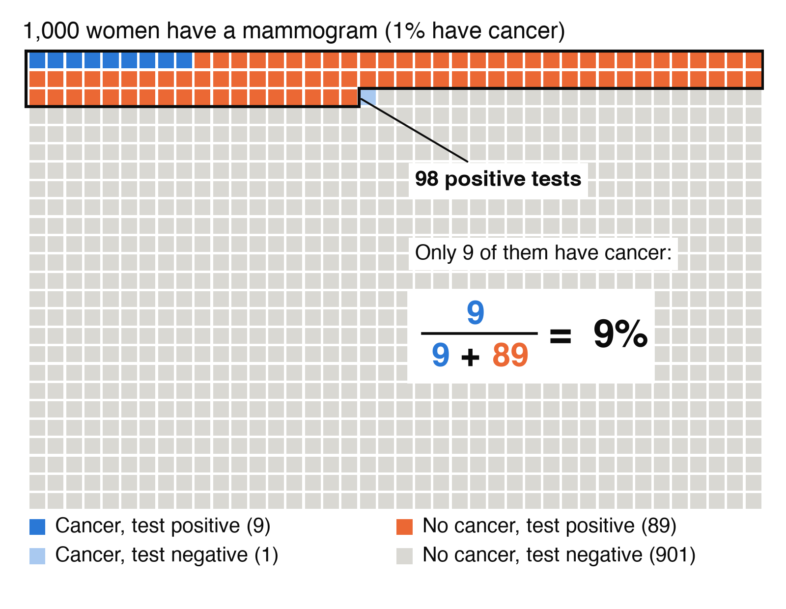{.pic style="max-height:629px"}

Numbers from Gigerenzer et al. (2007), Psychological Science in the Public Interest 8(2).
::::
:::

::: notes
Ask the class for a show of hands BEFORE you reveal the answer (most people say about 90%). Gigerenzer, Gaissmaier, Kurz-Milcke, Schwartz & Woloshin (2007) 'Helping doctors and patients make sense of health statistics', PSPI 8(2):53-96. In a 2007 training session, 160 gynaecologists got this problem as conditional probabilities; 21% chose the correct answer (about 1 in 10). After training in natural frequencies, most got it right. Natural frequencies: of 1,000 women, 10 have cancer and 9 of them test positive; of the 990 without cancer, about 89 test positive. 9 / (9 + 89) = 9%. On the chart, the outlined block is the 98 positive tests; only the 9 blue squares in it have cancer. This block is the denominator of Bayes' rule (slide 10). The numbers are a teaching example, not the current NHS screening figures.
:::

## The same pattern, in many places
<!-- slide 8 -->

::: {.columns}
:::: {.column width="49%"}
- Drunk driving is much more dangerous per mile, but most road deaths involve no drunk driver
- 8 of 9 women with breast cancer have no affected mother, sister or daughter
- My damage detector in Kharkiv: it flagged 32% of damaged buildings but only 0.9% of intact ones. Most flags were still intact buildings
- Also: COVID deaths in vaccinated people, DNA database matches, heart attacks at 'normal' cholesterol
- Geoffrey Rose: many people at a small risk can give more cases than a few people at a high risk
::::
:::: {.column width="51%"}
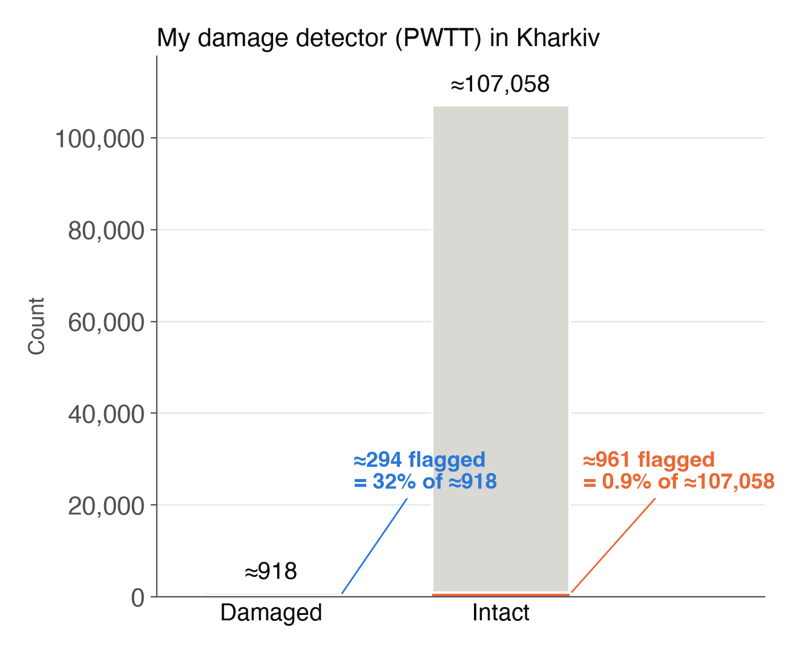{.pic style="max-height:631px"}

Chart: Ballinger (2025), Remote Sensing of Environment, Tables 1–2. Other sources: NHTSA (2022 data); Collaborative Group (2001), Lancet 358.
::::
:::

::: notes
Road deaths: NHTSA, 2022 data: 13,524 deaths in crashes with an alcohol-impaired driver (BAC 0.08+), 32% of all US traffic deaths. Breast cancer: Collaborative Group on Hormonal Factors in Breast Cancer (2001) 'Familial breast cancer', Lancet 358:1389-99: 'eight out of nine women who develop breast cancer do not have an affected mother, sister, or daughter'. Kharkiv (chart): 107,976 buildings, 0.85% damaged (≈918), recall 32.0% (≈294 true flags), precision 23.41%, so ≈961 false flags = 0.9% of ≈107,058 intact buildings (Ballinger 2025, Tables 1–2). The counts are approximate, because the paper's statistics are weighted by building area. Other examples to talk through: (1) In the UK in summer 2021, many COVID deaths were in vaccinated people, because nearly all older people were vaccinated. (2) A 1-in-a-million DNA match searched against a database of ~6 million profiles gives ~6 innocent matches. (3) Most heart-attack patients have 'normal' cholesterol (Sachdeva et al. 2009, Am Heart J). CHECK these before you quote numbers. Rose's prevention paradox: Rose (1985) 'Sick individuals and sick populations', Int J Epidemiol 14:32-38.
:::

## My research: same detector, very different precision
<!-- slide 9 -->

::: {.columns}
:::: {.column width="49%"}
- The Pixel-Wise T-Test (PWTT) flags damaged buildings in free radar imagery
- We tested it on 904,977 buildings in 30 cities, with UN damage labels
- Kremenchuk: the best AUC of all 30 cities (0.93), but only 3% of flags were real damage
    - Only 0.11% of its buildings were damaged
- Gaza: a lower AUC (0.78), but 74% of flags were real damage
    - 72% of its buildings were damaged
- The detector did not change. The base rate changed.
::::
:::: {.column width="51%"}
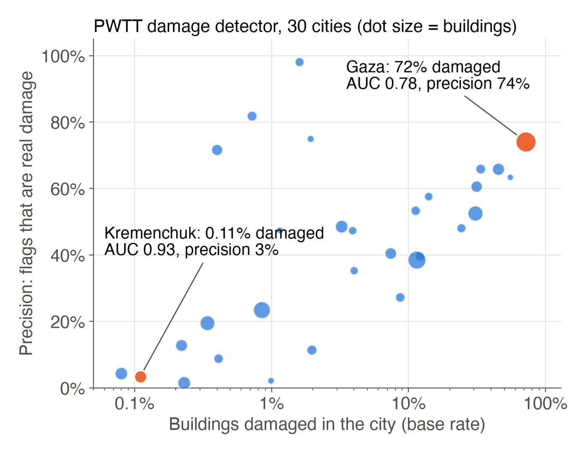{.pic style="max-height:629px"}

Source: Ballinger (2025), Remote Sensing of Environment, Tables 1–2. Statistics are weighted by building area.
::::
:::

::: notes
Own research. Ballinger (2025) 'Open Access Battle Damage Detection via Pixel-Wise T-Test on Sentinel-1 Imagery', Remote Sensing of Environment. Validation: Microsoft building footprints joined to UNOSAT damage annotations (10 m tolerance); 904,977 footprints. Each dot is a city: x = % of buildings damaged (Table 1), y = precision (Table 2). For each city the threshold of T comes from a precision-recall curve, and all statistics are weighted by building area. Rank correlation across the 30 cities: precision vs % damaged = +0.54; AUC vs % damaged = -0.32. So precision follows the base rate, while AUC (which does not depend on the base rate) does not. Kremenchuk: 27,497 buildings, 0.11% damaged (about 30 buildings), AUC 0.928, precision 3.44%, recall 2.99%. Gaza (UNOSAT, 4 April 2025): 228,728 buildings, 71.91% damaged, AUC 0.781, precision 74.09%, recall 91.98%. The paper makes the same point: F1 tends to zero as you add negatives, so compare cities with AUC; a balanced sample raises F1 for the full data from 65% to 80%. Lowest precision: Melitopol (1.5%, 0.23% damaged) and Antonivka (2.2%). Outliers: Bucha (98% precision at 1.6% damaged) and Antonivka (AUC 0.42, 905 buildings). Note: the abstract says 29 cities; Tables 1–2 list 30.
:::

## Bayes' rule {.smaller}
<!-- slide 10 -->

::: {.columns}
:::: {.column width="63%"}
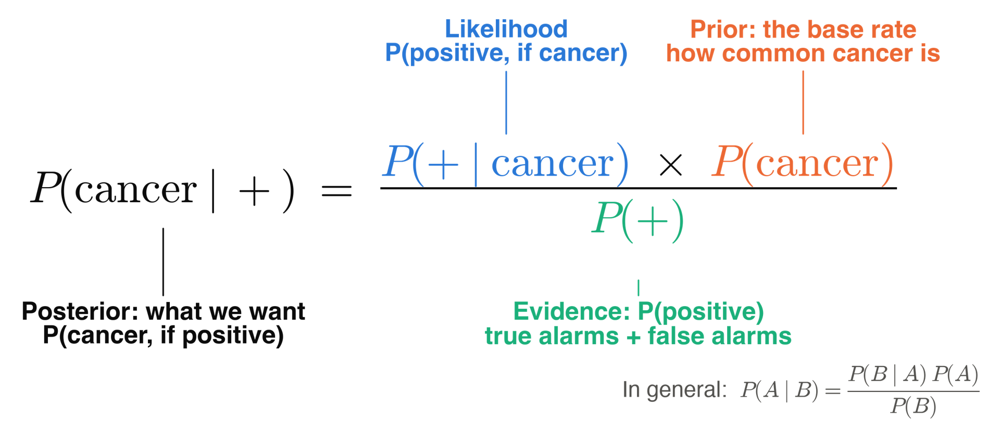{.pic style="max-height:420px"}

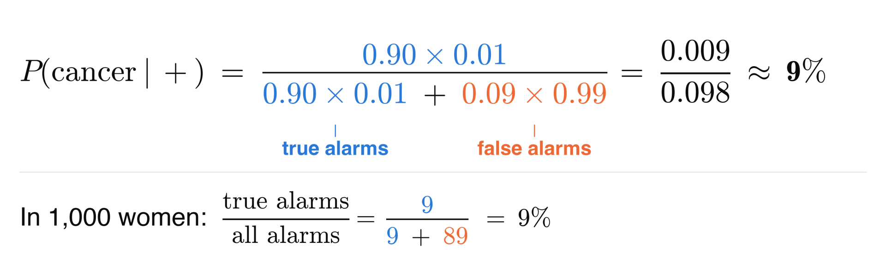{.pic style="max-height:280px"}
::::
:::: {.column width="37%"}
- How to read it, step by step:
    - 1. Start with the prior: 1% of women have cancer
    - 2. Multiply by the likelihood: 90% of them test positive. These are the true alarms
    - 3. Divide by the evidence: all positive tests, true alarms + false alarms
    - 4. The result is the posterior: 9%
- Trap: P(+ | cancer) = 90% is not P(cancer | +) = 9%
- The false alarms come from the big group, so they decide the answer
::::
:::

::: notes
Read the formula term by term, in colour. POSTERIOR (black): what we want, the chance of cancer given a positive test. LIKELIHOOD (blue): the chance of a positive test if she has cancer, the test's sensitivity, 90%. This is the number that people confuse with the posterior: P(+ | cancer) is not P(cancer | +). PRIOR (orange): the base rate before the test, 1%. EVIDENCE (green): the chance of a positive test at all, from both routes: true alarms (0.90 × 0.01 = 0.009) plus false alarms (0.09 × 0.99 = 0.0891), total 0.0981. Posterior = 0.009 / 0.0981 = 0.092, about 9%. The bottom line is the same sum in counts: of 1,000 women, 9 true alarms and 89 false alarms, so 9 of 98 alarms are real. The numerator is the true alarms; the denominator is all alarms. That is all Bayes' rule does. Why it works: P(A and B) = P(B | A) P(A) = P(A | B) P(B); divide both sides by P(B).
:::

## The base rate decides
<!-- slide 11 -->

::: {.columns}
:::: {.column width="49%"}
- The same test (90% sensitivity, 9% false alarms) at different base rates
- Rare condition: almost every alarm is false
- Common condition: most alarms are true
- So a result means different things in different populations
- To know the base rate, you need a good sample of the population: the rest of today
::::
:::: {.column width="51%"}
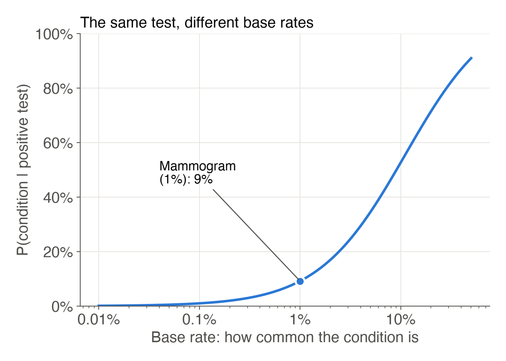{.pic style="max-height:624px"}

P(condition | positive) from Bayes' rule, with the prior on the x-axis.
::::
:::

::: notes
Each point on the curve is Bayes' rule with a different prior. At a 0.1% base rate, P(condition | +) is about 1%; at 1% it is 9%; at 10% it is 53%; at 50% it is 91%. This is why we screen high-risk groups, and why a rare-event detector (fraud, terrorism, illegal fishing, building damage) gives many false alarms. Bridge to the rest of the lecture: a base rate is a population quantity, and we usually estimate it from a sample.
:::

## {background-image="img/w05/slide_012.jpg" background-size="contain" .fallback}
<!-- slide 12 -->

::: notes
Go to menti

Slide text: War Planes · During World War II, U.S. bombers experienced heavy losses · The Navy asked the Statistical Research Group at Columbia University to help them figure out how to reduce losses  · Abraham Wald, an influential statistician, looked at a large sample of damaged planes that had returned from bombing runs, and made a diagram of each bullet hole
:::

## Selection Bias
<!-- slide 13 -->

- We rarely have all the data on a specific **population;** Often, we only have a **sample.**
- When a sample is drawn randomly, we can use the distribution of the sample to make inferences about the population.
- **Selection Bias** can occur when our sample is not randomly selected.
- Wald was interested in the **population** of bomber planes, but only observed a highly biased **sample:** those that returned.
    - This is known as **survivorship bias,** and is a subset of general **selection bias**

## Populations and Samples
<!-- slide 14 -->

- There are two kinds of distributions: populations and samples.
- **A population is the set of all relevant measurements**
- **A sample is a group of observations drawn in some way from a wider population**

| Population | Sample |
|---|---|
| All the fish in the sea | The fish I caught |
| The adult population of the UK | Census responses |
| All U.S. Navy Bomber planes | Bombers that made it back to base |
| All 19-20 year olds in the world | The people in this classroom |
| A person’s movements over a month | Mobile phone location pings |
| Public sentiment on race in South Africa | Tweets about race from South African users |

## Outline
<!-- slide 15 -->

1. Basic Statistics
1. The Central Limit Theorem
1. Quantifying Uncertainty

# Basic Statistics
<!-- slide 16 -->

## {background-image="img/w05/slide_017.jpg" background-size="contain" .fallback}
<!-- slide 17 -->

::: notes
Slide text: Sample mean
:::

## {background-image="img/w05/slide_018.jpg" background-size="contain" .fallback}
<!-- slide 18 -->

::: notes
Slide text: Sample median · The median of a set of n number of observations in a sample, ordered by value, of a variable is is defined by  ·  ·  ·  · Example (already in order): · Ages: 17, 19, 21, 22, 23, 23, 23, 38  · Median = (22+23) / 2 = 22.5  · The median also describes what a typical observation looks like, or where is the center of the distribution of the sample of observations.
:::

## {background-image="img/w05/slide_019.jpg" background-size="contain" .fallback}
<!-- slide 19 -->

::: notes
Slide text: Mean vs. Median · The mean is sensitive to extreme values (outliers)
:::

## {background-image="img/w05/slide_020.jpg" background-size="contain" .fallback}
<!-- slide 20 -->

::: notes
Slide text: Mean, median, and skewness · The mean is sensitive to outliers:  ·  ·  ·  ·  ·  ·  ·  · skewness often “follows the longer tail”.
:::

## {background-image="img/w05/bdaa6a7390.png" background-size="contain"}
<!-- slide 21 -->

## {background-image="img/w05/slide_022.jpg" background-size="contain" .fallback}
<!-- slide 22 -->

::: notes
Slide text: Regarding Categorical Variables... · For categorical variables, neither mean or median make sense. Why? ·  ·  ·  ·  ·  ·  ·  ·  · The mode might be a better way to find the most “representative” value.
:::

## Measures of Spread: Variance
<!-- slide 23 -->

::: {.columns}
:::: {.column width="58%"}
- The sample **variance**, s², measures how far, on average, the values are from the mean
- (xᵢ − x̄) is how far each value xᵢ is from the mean x̄. Squaring makes s² sensitive to extreme values (outliers)
- s² is not in the same units as the xᵢ: it is in squared units
- What does a variance of 1,008 mean? Or 0.0001?
::::
:::: {.column width="42%"}
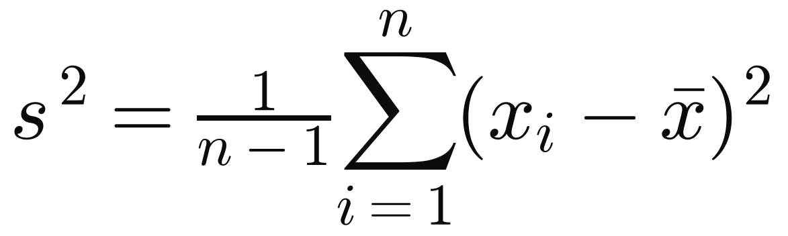{.pic style="max-height:700px"}
::::
:::

::: notes
We divide by n − 1, not n (Bessel's correction). The deviations are measured from the sample mean, which is always closer to the sample than the true population mean is, so dividing by n would underestimate the population variance. Older versions of this slide wrote |xᵢ − x̄|²; the absolute value does nothing once you square, so it is dropped.
:::

## {background-image="img/w05/slide_024.jpg" background-size="contain" .fallback}
<!-- slide 24 -->

::: notes
Slide text: Measures of Spread: Standard Deviation · The sample standard deviation, s, is the square root of the variance · s has the same units as the xᵢ, so it is easier to interpret than s²
:::

## {background-image="img/w05/slide_025.jpg" background-size="contain" .fallback}
<!-- slide 25 -->

::: notes
Sample A: mean = 5, sum of squared deviations = 58, s² = 58/9 = 6.444, s = 2.539. The histograms on the two slides use the same axes; the shaded band is the mean ± 1 s. The earlier version of this slide said 2.53; the correct value to 2 d.p. is 2.54.

Slide text: Sample A: High standard deviation · Sample A
:::

## {background-image="img/w05/slide_026.jpg" background-size="contain" .fallback}
<!-- slide 26 -->

::: notes
Sample B: mean = 5, sum of squared deviations = 0, s² = 0/9 = 0.000, s = 0.000. The histograms on the two slides use the same axes; the shaded band is the mean ± 1 s. Every value equals the mean, so every deviation is 0 and s = 0: there is no spread at all.

Slide text: Sample B: Zero standard deviation · Sample B
:::

# The Central Limit Theorem
<!-- slide 27 -->

## Inferring from samples
<!-- slide 28 -->

- There are generally equal numbers of men and women in the population\*;
- In other words, a random individual plucked from this population has a ~50% chance of being a man or a woman.
- Let’s assume a variable where woman=1, man=0
- If I take a random sample of 4 people,
    - we might expect 2 men and 2 women, or a [0,0,1,1] sample
    - But we might not be entirely surprised if we got all men [0,0,0,0] or all women [1,1,1,1].
    - Similarly, you could flip a coin 4 times and get all heads or all tails.

## {background-image="img/w05/slide_029.jpg" background-size="contain" .fallback}
<!-- slide 29 -->

::: notes
Slide text: Inferring from samples · But what are the chances of flipping a coin 100 times and never getting heads? Or drawing a random sample of 100 people and none of them are women? Probably extremely low. How low?
:::

## {background-image="img/w05/slide_030.jpg" background-size="contain" .fallback}
<!-- slide 30 -->

::: notes
Slide text: Inferring from samples · Turns out, if you plot the means from sufficiently large random samples, they approximate a normal distribution · The mean of the sample means will approach the population mean
:::

## Central Limit Theorem
<!-- slide 31 -->

- This is the most important concept you will learn in this course.
- If you take sufficiently large random samples from the population,

[**The distribution of sample means will be approximately normally distributed**]{style="display:block;text-align:center"}

- *Regardless of the underlying population distribution*

## Why does this matter?
<!-- slide 32 -->

- This means that **we can use the normal probability model to quantify uncertainty when making inferences about a population mean based on the sample mean.**
- In other words, because we know the shape of the normal distribution, we can precisely estimate the likelihood of observing a sample mean as extreme as the one we have
- We rarely observe the whole population, but if we have a large enough random sample, **we can assume that the mean of this sample has a:**
    - 68% chance of falling within 1 standard deviation of the population mean
    - 95% chance of falling within 2 standard deviations of the population mean
    - 99.7% chance of falling within 3 standard deviations of the population mean

## {background-image="img/w05/slide_033.jpg" background-size="contain" .fallback}
<!-- slide 33 -->

::: notes
Slide text: Estimating Union membership in America · “Union” is a binary variable, in which  · 0= person is not a member of a union · 1= person is a member of a union  · I don’t know what the rate of union membership is in the population.  · But lets say I can draw a random sample of 7 people from across the U.S.
:::

## {background-image="img/w05/slide_034.jpg" background-size="contain" .fallback}
<!-- slide 34 -->

::: notes
Slide text: Again, it’s possible that none of them would be union members  · i.e., our sample would look like this: [0,0,0,0,0,0,0,0], with a mean of 0. · Given such a small sample, there’s a decent chance that our sample mean would be 0 due to pure chance. · Estimating Union membership in America
:::

## Estimating Union membership in America
<!-- slide 35 -->

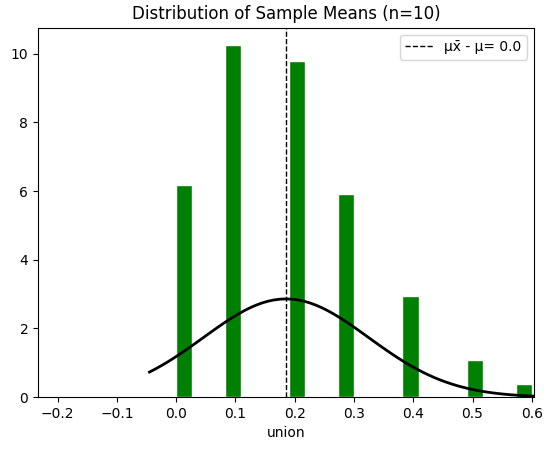{.r-stretch fig-align="center"}

## Estimating Union membership in America
<!-- slide 36 -->

::: {.columns}
:::: {.column width="50%"}
- What if we took a random sample of 1000 people.
    - How likely is it that not a single person in the sample is a member of a union?
    - **Given such a large sample, it’s unlikely that our sample mean would be 0 due to pure chance.**
- **But how unlikely?**
::::
:::: {.column width="50%"}
{.pic style="max-height:700px"}
::::
:::

## Estimating Union membership in America
<!-- slide 37 -->

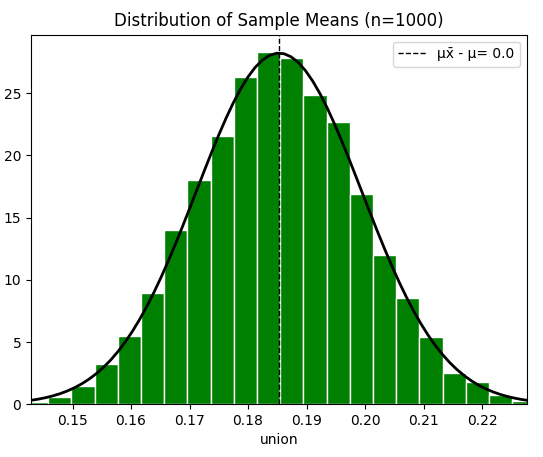{.r-stretch fig-align="center"}

## The distribution of sample means becomes normal, regardless of the underlying distribution
<!-- slide 38 -->

::: {.columns}
:::: {.column width="53%"}
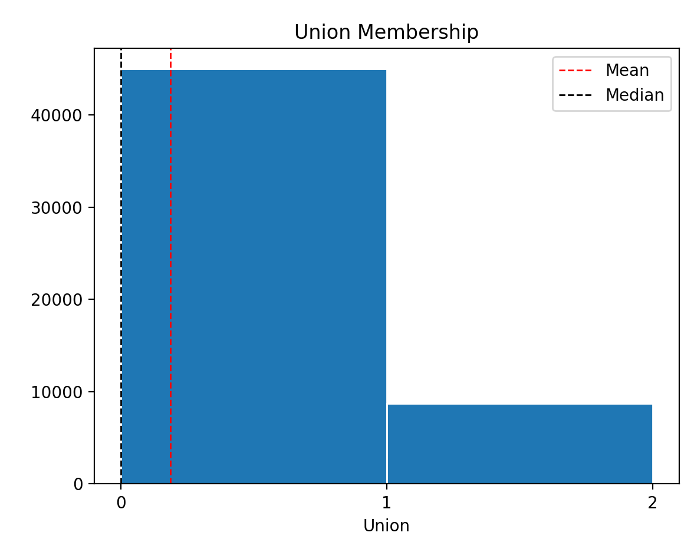{.pic style="max-height:700px"}
::::
:::: {.column width="47%"}
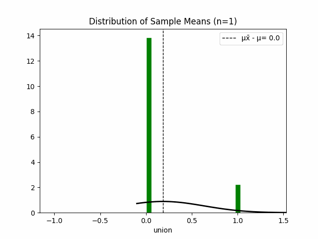{.pic style="max-height:700px"}
::::
:::

## The distribution of sample means becomes normal, regardless of the underlying distribution
<!-- slide 39 -->

::: {.columns}
:::: {.column width="50%"}
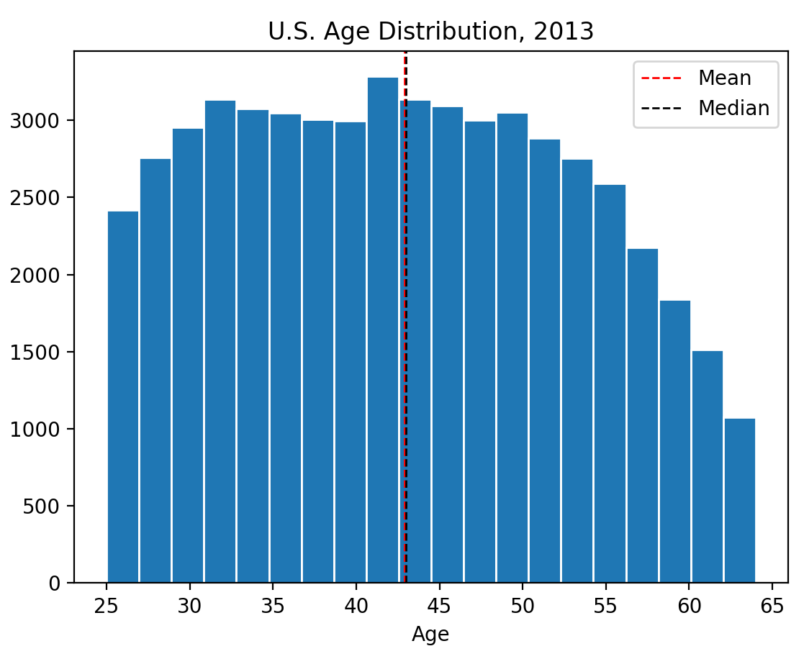{.pic style="max-height:700px"}
::::
:::: {.column width="50%"}
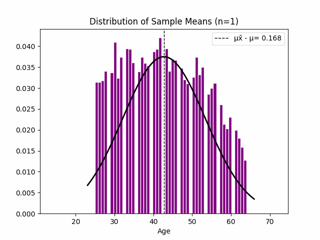{.pic style="max-height:700px"}
::::
:::

## The distribution of sample means becomes normal, regardless of the underlying distribution
<!-- slide 40 -->

::: {.columns}
:::: {.column width="51%"}
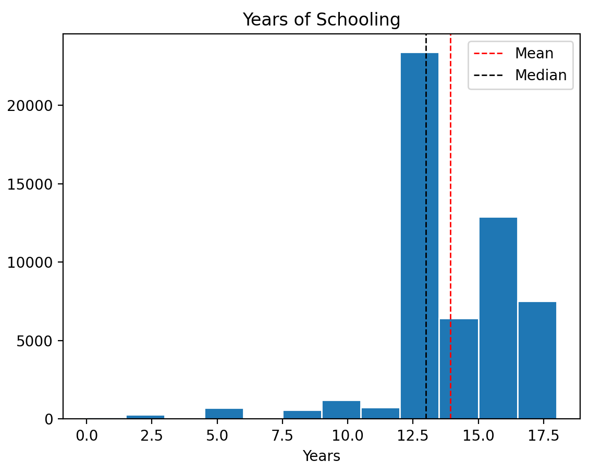{.pic style="max-height:700px"}
::::
:::: {.column width="49%"}
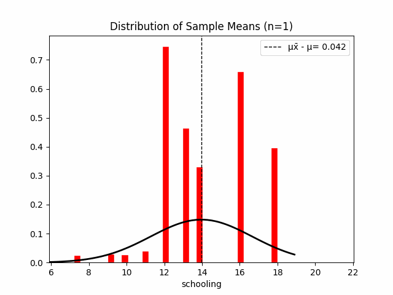{.pic style="max-height:700px"}
::::
:::

## The distribution of sample means becomes normal, regardless of the underlying distribution
<!-- slide 41 -->

::: {.columns}
:::: {.column width="51%"}
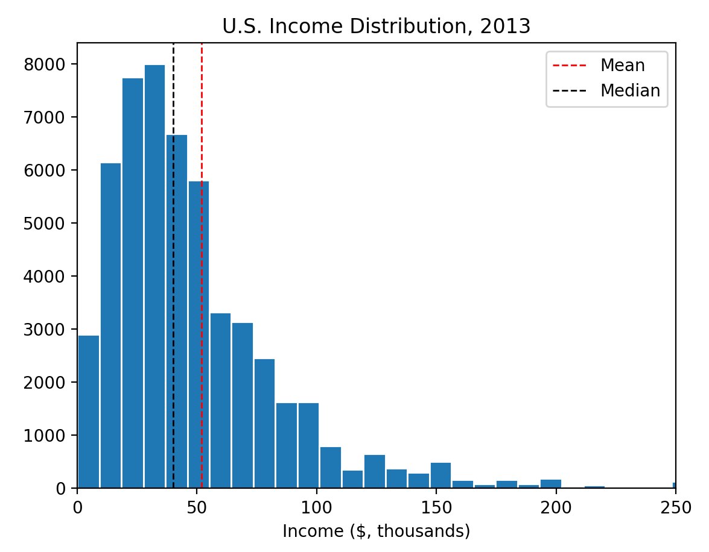{.pic style="max-height:700px"}
::::
:::: {.column width="49%"}
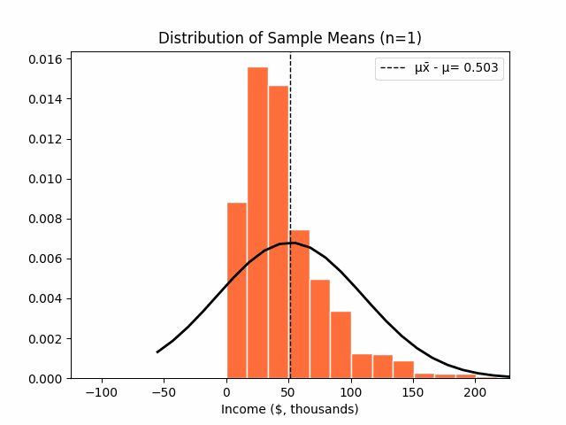{.pic style="max-height:700px"}
::::
:::

## Why the CLT is ✨magic✨
<!-- slide 42 -->

- In these examples, I’ve had access to the entire population and have been drawing thousands of large samples to show that their means are normally distributed.
- If you have **one sufficiently large random sample, you can ASSUME** that the distribution of sample means will be normally distributed.
    - You can **ASSUME** that the mean of your sample has a 95% chance of falling within 2 standard deviations of the population mean

# Quantifying Uncertainty
<!-- slide 43 -->

## The Signal and the Noise
<!-- slide 44 -->

- Signal
    - meaningful information that you're actually trying to detect.
- Noise
    - random, unwanted variation or fluctuation that interferes with the signal.
- Sometimes we may observe a strong signal
    - E.g. a big difference between two values (e.g. income for men vs women)
    - But there may be big differences between *all* the values; in other words, there may be lots of noise. The observed difference could be due to chance.
    - If there’s a big difference in our two values, but the rest of the values are close together, the likelihood that our observed difference is due to chance is low.

## {background-image="img/w05/slide_045.jpg" background-size="contain" .fallback}
<!-- slide 45 -->

::: notes
Slide text: The Signal and the Noise · The challenge of inference is understanding how likely it is that the signal we’re observing is due to random chance (noise).  · Most inferential statistics are basically a ratio of signal to noise:
:::

## {background-image="img/w05/slide_046.jpg" background-size="contain" .fallback}
<!-- slide 46 -->

::: notes
Slide text: Signal · Noise · Noise · N   o   i   s   e · N   o   i   s   e
:::

## Recap
<!-- slide 47 -->

1. A **population** is the set of all relevant measurements
1. A **sample** is a group of observations drawn in some way from a wider population
1. If you take sufficiently large random samples from the population,
    1. **The distribution of** **sample** **means will be approximately normally distributed**
1. If you have **one sufficiently large random** **sample****, you can ASSUME** that the distribution of sample means will be normally distributed.
    1. You can **ASSUME** that the mean of your sample has a 95% chance of falling within 2 standard deviations of the population mean

## Any Questions?
<!-- slide 48 -->

[[o.ballinger@ucl.ac.uk](mailto:o.ballinger@ucl.ac.uk)]{style="display:block;text-align:center"}
