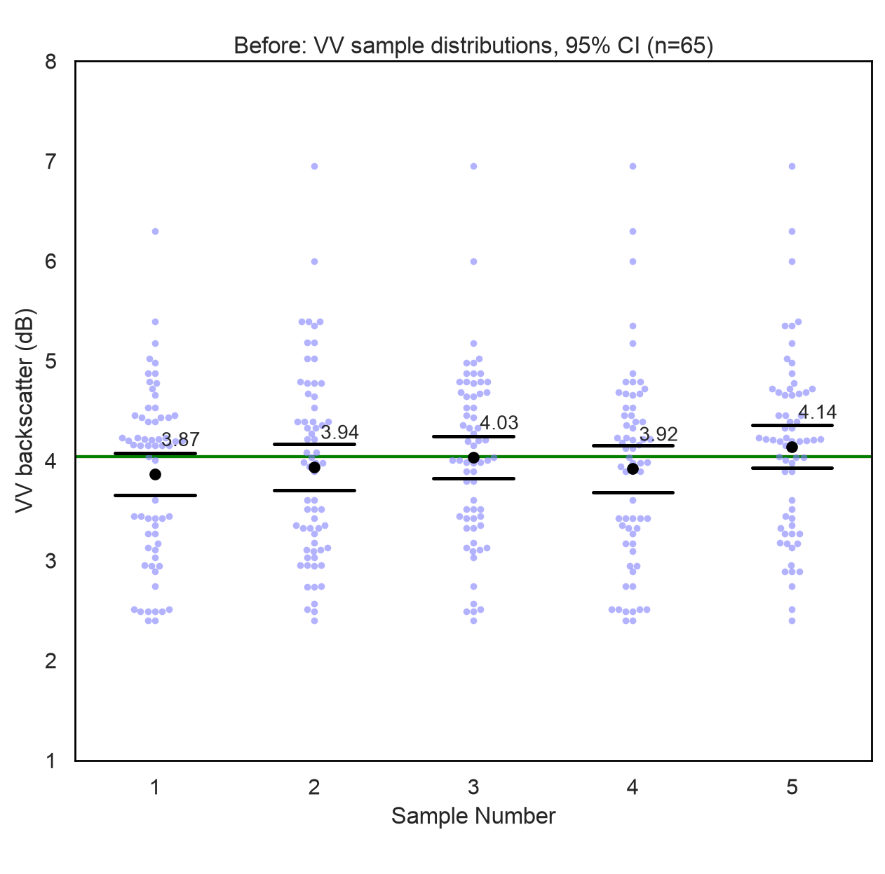
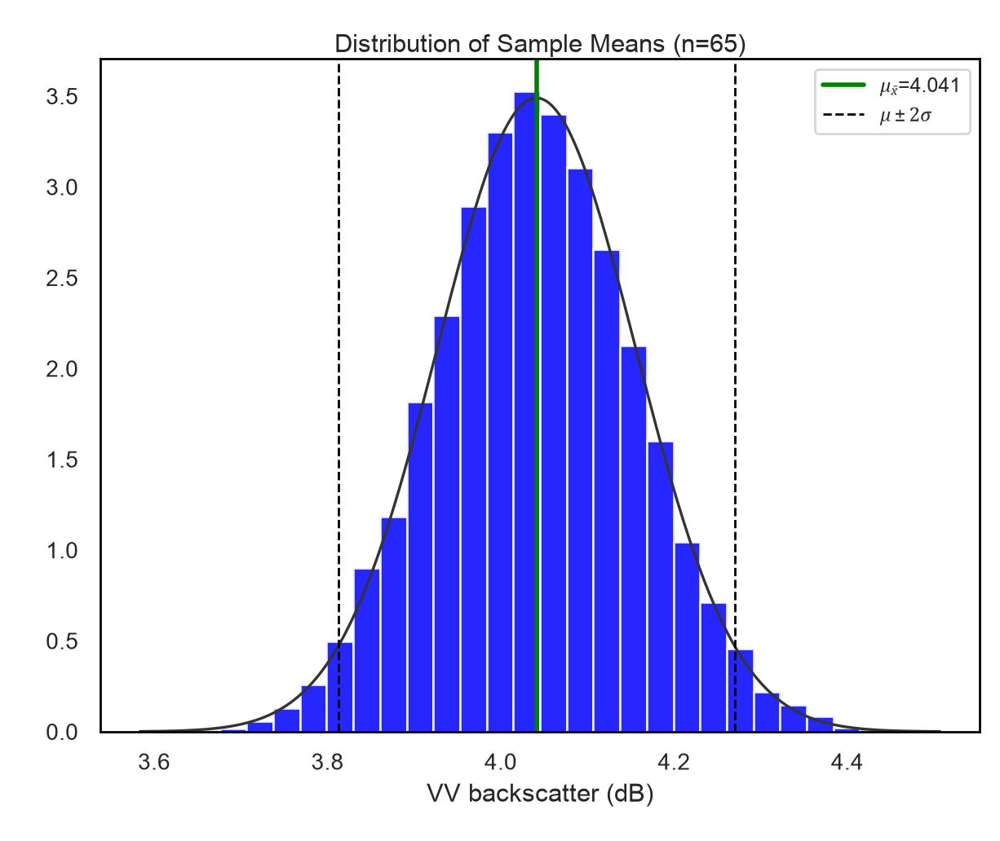
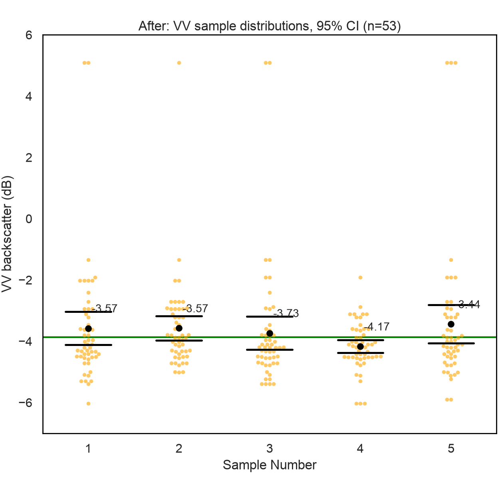
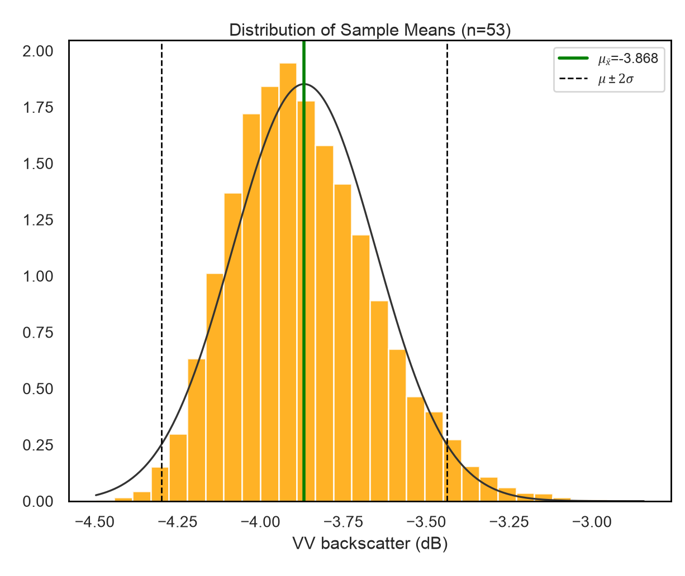
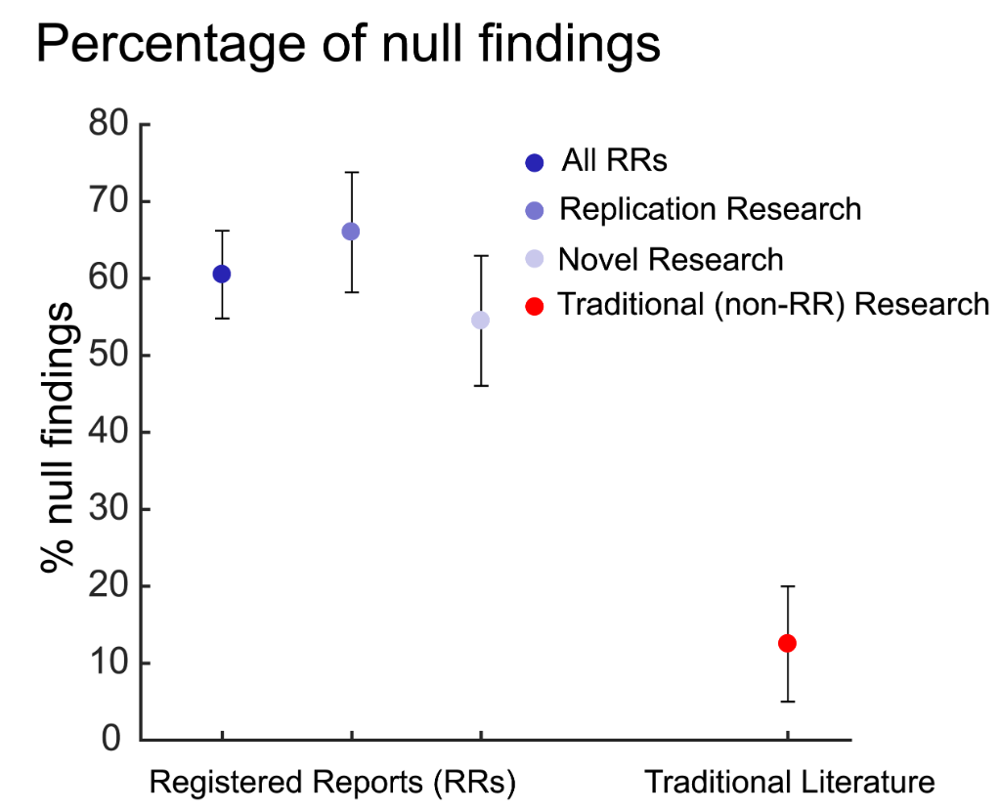
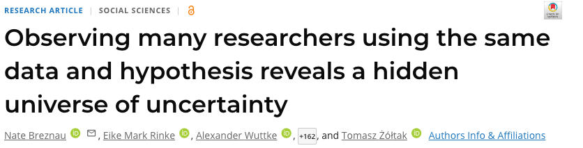

## {background-image="img/w06/slide_002.jpg" background-size="contain" .fallback}
<!-- slide 2 -->

::: notes
Slide text: The Data Science Process: · Ask a Question · Get the Data · Explore the Data · Model the Data · Visualize the Results · Build a model · Fit the model  · Validate the model
:::

## Problem
<!-- slide 3 -->

Satellite imagery is used extensively to detect damaged buildings. The highest levels of accuracy are generally achieved using Deep Learning and Very High Resolution optical satellite imagery. However, such approaches have significant limitations:

- Financially and computationally expensive
    - $23/km2, so **$13.9 million** for all of Ukraine
- Optical imagery is not consistently available
    - High-resolution imagery must be tasked
    - Clouds.
- Neural Networks require retraining to be accurate in different geographies.

## {background-image="img/w06/slide_004.jpg" background-size="contain" .fallback}
<!-- slide 4 -->

::: notes
Slide text: Detecting Damage from Space · Sentinel-1 SAR imagery is free, has a high revisit rate, and can penetrate clouds. Static structures are highly consistent in multitemporal imagery. A destructive event results in a change in backscatter amplitude, but relatively low variance in pixel values in both the pre- and post- shock periods for damaged buildings. A standard T-test can be used to calculate the ratio of the change in amplitude to general pixel variance, detecting collapsed buildings.
:::

## {background-image="img/w06/bc7b83f38b.png" background-size="contain"}
<!-- slide 5 -->

## {background-image="img/w06/568321a454.png" background-size="contain"}
<!-- slide 6 -->

## {background-image="img/w06/3eae8586fa.png" background-size="contain"}
<!-- slide 7 -->

## {background-image="img/w06/9f14aee4cb.png" background-size="contain"}
<!-- slide 8 -->

## {background-image="img/w06/slide_009.jpg" background-size="contain" .fallback}
<!-- slide 9 -->

::: notes
Slide text: Model Output · The result is a damage probability raster, in which each pixel value reflects the average of four T-values. On the right, the PWTT algorithm is applied to Beirut following the explosion in August 2020.
:::

## {background-image="img/w06/slide_010.jpg" background-size="contain" .fallback}
<!-- slide 10 -->

::: notes
2022- present

Abstract: 

In the context of recent, highly destructive conflicts in Gaza and Ukraine, reliable estimates of building damage are essential for an informed public discourse, human rights monitoring, and humanitarian aid provision. Given the contentious nature of conflict damage assessment, these estimates must be fully reproducible, explainable, and derived from open access data. This paper introduces a new method for building damage detection-- the Pixel-Wise T-Test (PWTT)-- that satisfies these conditions. Using a combination of freely-available synthetic aperture radar imagery and statistical change detection, the PWTT generates accurate conflict damage estimates across a wide area at regular time intervals. Accuracy is assessed using an original dataset of over half a million labeled building footprints spanning 12 cities across Ukraine, Palestine, Syria, and Iraq. Despite being simple and lightweight, the algorithm achieves building-level accuracy statistics (AUC=0.88 across Ukraine, 0.81 in Gaza) rivalling state of the art methods that use deep learning and high resolution imagery. The workflow is open source and deployed entirely within the Google Earth Engine environment, allowing for the generation of interactive Battle Damage Dashboards for Ukraine and Gaza that update in near-real time, allowing the public and humanitarian practitioners to immediately get estimates of damaged buildings in a given area.

Slide text: Open Access Battle Damage Detection via Pixel-Wise T-Test on Sentinel-1 Imagery
:::

## Outline
<!-- slide 11 -->

1. Case Study
1. Confidence Intervals
1. The T-Test
1. Bayes' Theorem: a brief look

# 2. Confidence Intervals
<!-- slide 12 -->

## {background-image="img/w06/slide_013.jpg" background-size="contain" .fallback}
<!-- slide 13 -->

::: notes
Data: Sentinel-1 VV backscatter (dB) of one 10 m pixel on a house in Mariupol, Ukraine. 118 images, 10 Jan 2020 to 14 Nov 2023, one image every 12 days. This is Figure 2 of Ballinger (2025), Remote Sensing of Environment. Before = images before the invasion (24 Feb 2022; last one 16 Feb 2022). After = images on or after 24 Feb 2022 (first one 28 Feb 2022). The red line is the mean of all images.

Slide text: Was this building destroyed? · I have 118 radar images of one pixel in Mariupol: 65 before the invasion and 53 after
:::

## {background-image="img/w06/slide_014.jpg" background-size="contain" .fallback}
<!-- slide 14 -->

## Sampling Error
<!-- slide 15 -->

- If multiple samples are taken from the same population, there still will be some difference between the sample means.
- This difference is called **sampling error**
- The hypothesis test provides a standardized, formal procedure for determining whether the mean difference obtained in a research study is significantly greater than can be explained by sampling error

## {background-image="img/w06/574403575d.png" background-size="contain"}
<!-- slide 16 -->

::: notes
Here the 65 images before the invasion are the population. Each panel shows 5 random samples (with replacement, fixed seed) of size n. The red line is the population mean (4.04 dB). As n grows from 5 to 50, the sample means move closer to the red line.
:::

## {background-image="img/w06/c3dba57551.png" background-size="contain"}
<!-- slide 17 -->

## {background-image="img/w06/ceec1f1671.png" background-size="contain"}
<!-- slide 18 -->

## {background-image="img/w06/cba55eca15.png" background-size="contain"}
<!-- slide 19 -->

## {background-image="img/w06/9a27bf52bc.png" background-size="contain"}
<!-- slide 20 -->

## {background-image="img/w06/40bbeb3205.png" background-size="contain"}
<!-- slide 21 -->

::: notes
The same thing for the 53 images after the invasion, with n = 50. The red line is their mean (−3.87 dB).
:::

## CLT Recap
<!-- slide 22 -->

- If you take a big enough (usually n>30) random sample, you can safely assume that 95% of the time,
    - **The** **population mean** **will lie within two standard errors of the observed** **sample mean.**
- If you have **one sufficiently large random sample, you can ASSUME** that the distribution of sample means will be normally distributed.
    - You can ASSUME that the mean of your sample has a 95% chance of falling within 2 **standard errors** of the population mean

## {background-image="img/w06/slide_023.jpg" background-size="contain" .fallback}
<!-- slide 23 -->

::: notes
Slide text: Standard Error
:::

## {background-image="img/w06/slide_024.jpg" background-size="contain" .fallback}
<!-- slide 24 -->

::: notes
The table shows the first 9 images after the invasion (28 Feb 2022 to 04 Jun 2022). The first image (28 Feb 2022) is still high: 5.09 dB. The drop starts with the next image (12 Mar 2022). The largest squared deviation is 80.28, on 28 Feb 2022, so this one image makes s_after larger. Over all 53 images, s_after = 1.57. Over the 65 images before, s_before = 0.93.

Slide text: Calculate the standard deviation
:::

## {background-image="img/w06/slide_025.jpg" background-size="contain" .fallback}
<!-- slide 25 -->

## {background-image="img/w06/slide_026.jpg" background-size="contain" .fallback}
<!-- slide 26 -->

::: notes
Slide text: Building a Confidence Interval
:::

## {background-image="img/w06/slide_027.jpg" background-size="contain" .fallback}
<!-- slide 27 -->

::: notes
Slide text: 95% Confidence Interval,Before
:::

## {.notitle}
<!-- slide 28 -->

::: {.columns}
:::: {.column width="54%"}
{.pic style="max-height:700px"}
::::
:::: {.column width="46%"}
{.pic style="max-height:700px"}
::::
:::

::: notes
Left: 5 resamples of 65 images (with replacement) from the images before the invasion, each with its 95% CI. Right: the means of 10,000 such resamples. The spread of these means is close to se = s/√n. Red line: mean of the 65 images. Green line: mean of the 10,000 resample means.
:::

## {background-image="img/w06/slide_029.jpg" background-size="contain" .fallback}
<!-- slide 29 -->

::: notes
Slide text: 95% Confidence Interval,After
:::

## {.notitle}
<!-- slide 30 -->

::: {.columns}
:::: {.column width="54%"}
{.pic style="max-height:700px"}
::::
:::: {.column width="46%"}
{.pic style="max-height:700px"}
::::
:::

## {background-image="img/w06/138b7a940c.png" background-size="contain"}
<!-- slide 31 -->

## {background-image="img/w06/slide_032.jpg" background-size="contain" .fallback}
<!-- slide 32 -->

# 3. The T-Test
<!-- slide 33 -->

## Independent-Measures Designs
<!-- slide 34 -->

- The independent-measures design is used in situations where a researcher has no prior knowledge about either of the two populations (or treatments) being compared.
- In particular, the population means and standard deviations are all unknown.
- Because the population variances are not known, these values must be estimated from the sample data.
- The purpose of a T-test is to determine
    - **whether the sample mean difference indicates a real mean difference between the two populations** or
    - **whether the obtained difference is simply the result of sampling error.**

## {background-image="img/w06/slide_035.jpg" background-size="contain" .fallback}
<!-- slide 35 -->

::: notes
Slide text: The Student’s T-Test · Developed by William Sealy Gosset in 1908, who worked for Guinness at the time · “How can we determine, to a reasonable degree of scientific certainty, if one variety of barley yields more than another?”
:::

## {background-image="img/w06/slide_036.jpg" background-size="contain" .fallback}
<!-- slide 36 -->

::: notes
Slide text: T-Test Formula
:::

## {background-image="img/w06/slide_037.jpg" background-size="contain" .fallback}
<!-- slide 37 -->

::: notes
Slide text: T-Test
:::

## {background-image="img/w06/slide_038.jpg" background-size="contain" .fallback}
<!-- slide 38 -->

::: notes
Slide text: T-Test
:::

## {background-image="img/w06/slide_039.jpg" background-size="contain" .fallback}
<!-- slide 39 -->

::: notes
Slide text: T-Test
:::

## {background-image="img/w06/slide_040.jpg" background-size="contain" .fallback}
<!-- slide 40 -->

::: notes
Slide text: Was this building destroyed?
:::

## {background-image="img/w06/slide_041.jpg" background-size="contain" .fallback}
<!-- slide 41 -->

::: notes
Slide text: Hypothesis Test steps
:::

## {background-image="img/w06/slide_042.jpg" background-size="contain" .fallback}
<!-- slide 42 -->

::: notes
Slide text: 1. The Null and Alternative Hypotheses
:::

## {background-image="img/w06/slide_043.jpg" background-size="contain" .fallback}
<!-- slide 43 -->

::: notes
Slide text: 2. Select a Critical Value · If we want to test the null hypothesis at the 95% confidence level, we would select a critical value of 1.96.   · If our T-statistic exceeds this value, we reject the null hypothesis that there is no difference between the group means.
:::

## {background-image="img/w06/5be88f4e2fcaa14.png" background-size="contain"}
<!-- slide 44 -->

## {background-image="img/w06/slide_045.jpg" background-size="contain" .fallback}
<!-- slide 45 -->

::: notes
Exact values: before n = 65, mean = 4.042, s = 0.930; after n = 53, mean = -3.866, s = 1.573. Welch t = 32.29. The slide rounds each step to 2 or 3 decimals. The denominator uses s squared over n for each group.

Slide text: 3. Calculate the test statistic
:::

## 4. Make a Decision
<!-- slide 46 -->

- The T-statistic from our T test is 32.3, which exceeds the critical value of 1.96.
- Therefore, we can **reject** the null hypothesis that there is no difference in mean VV backscatter before and after the invasion at 95% confidence.
- Interpretation:
    - In 65 images before and 53 images after the invasion, the mean VV backscatter fell by 7.91 dB. The difference in these means is statistically significant at the 95% confidence level.
    - i.e., there is less than a 5% chance of observing such an extreme difference in means between these two groups due to random chance alone.

::: notes
The PWTT computes exactly this t for every pixel, for each orbit and polarisation, and keeps the largest absolute value (Ballinger 2025, eq. 3-4). Caveat: the images form a time series of one pixel, so they are not fully independent. The paper does not use t as a strict p-value. It turns the t values into a 'damage probability raster' and classifies a building as damaged when T is above a threshold (T > 3.2 for all cities, chosen with a precision-recall curve). The first image after the invasion (28 Feb 2022) is still high (5.09 dB); the drop starts on 12 Mar 2022.
:::

## {background-image="img/w06/slide_047.jpg" background-size="contain" .fallback}
<!-- slide 47 -->

::: notes
Control: the same test on a second pixel in Mariupol, on the same 118 dates. Before: n = 65, mean = 10.209 dB, s = 2.380. After: n = 53, mean = 10.708 dB, s = 2.020. Welch t = -1.234, p = 0.22. Caveats: (1) This series is raw Sentinel-1 GRD VV in dB (relative orbit 43). The damaged series comes from the paper's figure, and its exact processing could not be reproduced. So do not compare the levels of the two pixels (about 10 dB here, about 4 dB there). Compare only the change from before to after. (2) t is not 0. Noise gives a non-zero t even when nothing is damaged. That is why we need a critical value. (3) Code chose this pixel: stable backscatter, on a Microsoft building footprint, and no UNOSAT damage point within 250 m (22 within 500 m). Nobody checked it visually.

Slide text: Control: The Same Test, No Damage · Control pixel: 47.11324 N, 37.54854 E (Mariupol), on a building footprint. No UNOSAT damage point within 250 m.
:::

## Control: Make a Decision
<!-- slide 48 -->

- The T-statistic for the control pixel is −1.23. Its absolute value is less than the critical value of 1.96.
- Therefore, we **fail to reject** the null hypothesis that there is no difference in mean VV backscatter before and after the invasion.
- Interpretation:
    - For this pixel, the mean VV backscatter changed by only 0.50 dB (10.21 dB before, 10.71 dB after).
    - t is not exactly 0: noise alone gives a small t. That is why we compare t with a critical value. The same test on an undamaged building gives no signal.

::: notes
|t| = 1.23 < 1.96, so we fail to reject H0. Failing to reject H0 does not prove that nothing changed. It says that this test finds no difference larger than the normal variation of this pixel. This is also how the PWTT keeps false alarms low: a stable pixel gets a small |t|.
:::

## {background-image="img/w06/slide_049.jpg" background-size="contain" .fallback}
<!-- slide 49 -->

::: notes
Slide text: Summary of key terms
:::

## A Note of Caution
<!-- slide 50 -->

::: {.columns}
:::: {.column width="51%"}
- Hypothesis testing is the basis of modern scientific research.
- They allow us to evaluate the likelihood of our test results being attributable to random chance.
- But, statistically significant results can be misleading
    - **Publication bias** (a form of selection bias in academic publishing) is a real threat.
    - **Bayes’** **Theorem** suggests that many statistically significant research findings may be false.
::::
:::: {.column width="49%"}
{.pic style="max-height:636px"}

Source: [Adrian Barnett](https://agbarnett.github.io/talks/TRI/slides)
::::
:::

## Where do null findings go?
<!-- slide 51 -->

::: {.columns}
:::: {.column width="52%"}
{.pic style="max-height:700px"}
::::
:::: {.column width="48%"}
{.pic style="max-height:700px"}
::::
:::

## {.notitle}
<!-- slide 52 -->

{.pic style="max-height:230px"}

{.pic style="max-height:470px"}

## {background-image="img/w06/8b947f61c4.jpg" background-size="contain"}
<!-- slide 53 -->

## Bayes' Theorem: Explore It Below
<!-- slide 54 -->

- Posterior = Likelihood × Prior / Evidence
    - P(damaged | flagged) = P(flagged | damaged) × P(damaged) / P(flagged)
- Use the interactive applet below these slides on the course page
    - Choose a city: the same PWTT damage detector, a different base rate
    - Move the sliders and watch the posterior change
- A detector can be good and still give mostly false alarms when damage is rare

::: notes
Open the Week 6 page (slides/w06 on the course site) and scroll below the slides to the Bayes applet. Suggested demo: start with All 30 cities (posterior 59%), then Kharkiv (about 2% damaged: 23% of flags are real), then Gaza (about 62% damaged: 74%). The detector is the same; the prior changes. Then use 'Test it a second time'. Numbers: Ballinger (2025), RSE, Table 2 (area-weighted); the prior and false-alarm rate for each city are derived from Table 2.
:::

## Recap
<!-- slide 55 -->

- The purpose of a T-test is to determine
    - **whether the sample mean difference indicates a real mean difference between the two populations** or
    - **whether the obtained difference is simply the result of sampling error.**
- Hypothesis testing has 4 steps:
    1. State the hypotheses.
    1. Select an α level (e.g. 95%, 99%) and locate the critical region.
    1. Compute the test statistic.
    1. Make a decision
- The hypothesis testing procedure, and the T-Test, are foundational to empirical research from medicine to social and physical sciences.
- But, just because a result is statistically significant, doesn’t mean it’s true!

## Any Questions?
<!-- slide 56 -->

[[o.ballinger@ucl.ac.uk](mailto:o.ballinger@ucl.ac.uk)]{style="display:block;text-align:center"}
